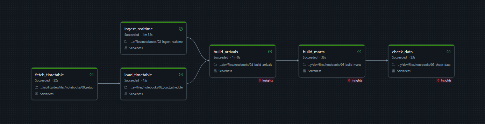
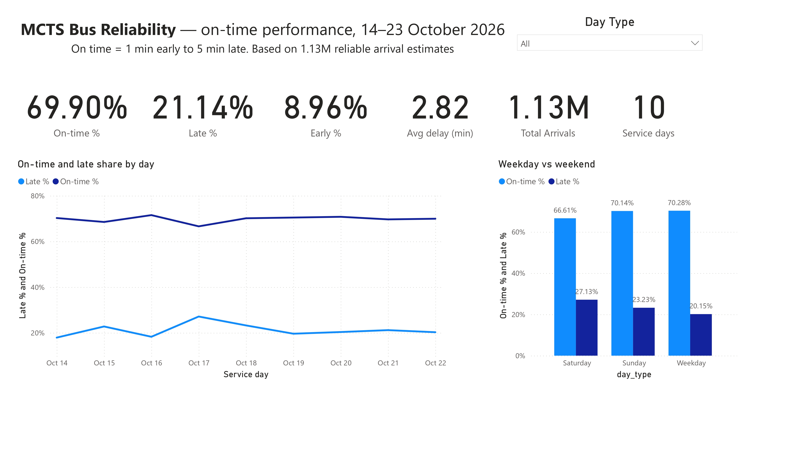
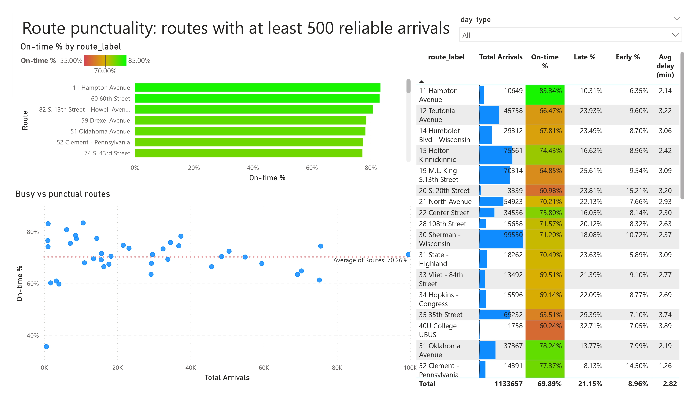
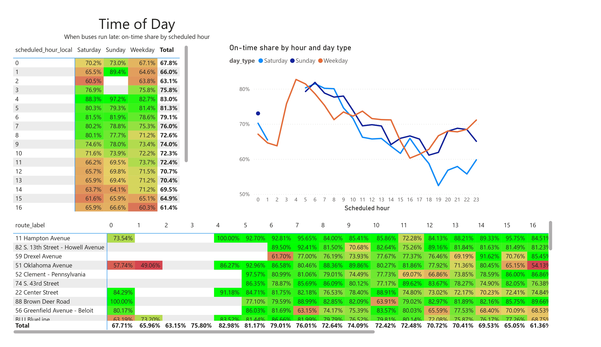
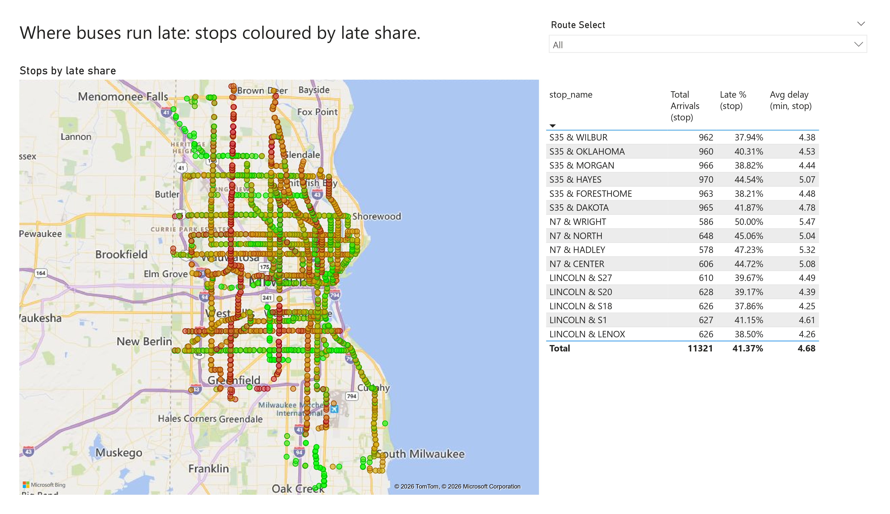
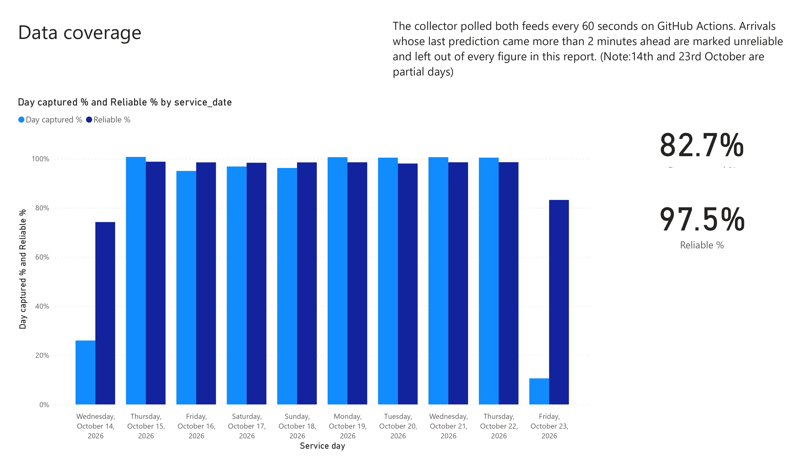
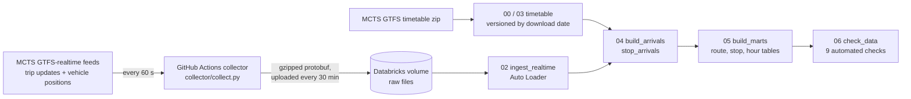

# MCTS Bus Reliability

How punctual are Milwaukee County Transit System (MCTS) buses? This project collects MCTS's live bus feeds
every minute, works out when each bus actually reached each stop, compares that with the published timetable,
and reports on-time performance by route, stop and hour. It runs on its own every day, entirely on free tools.

**Status:** complete. Data was collected from 14 to 23 October 2026: 10 service days, with the first and last only partly covered.

## Results

| Measure | Value |
| --- | --- |
| Feed snapshots collected | 11,914 (about 83% of each day captured; 23.5M trip-update rows, 1.6M vehicle positions) |
| Trip-stop arrivals estimated | 1,164,011 (97.5% reliable) |
| Predicted trip-stops matched to the timetable | 99.7% |
| Median lead time of the final prediction | 28 seconds |
| Arrivals on time (1 min early to 5 min late) | 69.9% |
| Arrivals more than 5 min late | 21.1% |
| Arrivals more than 1 min early | 9.0% |
| Average delay | 2.82 min (90th percentile 7.35 min) |

- **Most punctual routes** (at least 500 arrivals): 11 Hampton Avenue (83.3% on time), 60 60th Street (83.1%) and
  82 S. 13th Street – Howell Avenue (80.7%, though 15.5% of its arrivals were more than a minute early).
- **Least punctual routes:** RR2 Via PurpleLine (35.7%, mostly *early*: 39.7%), 58 Villard Avenue (59.8%, 37.4% late)
  and 40U College UBUS (60.2%). Among the busiest routes, 76 76th Street stands out: 75,228 arrivals at 61.4% on
  time, with 31.7% late.
- **Weekday vs weekend:** weekdays (70.3%) and Sundays (70.1%) were similar; Saturdays were worst at 66.6%, with
  27.1% of arrivals late.
- **Time of day (weekdays):** punctuality is best in the early morning (82.7% at 4 AM, 81.4% at 5 AM) and falls
  through the day to its low in the afternoon peak (60.3% at 4 PM, 61.4% at 5 PM), recovering in the evening.

All figures use only *reliable* arrival estimates (see [How arrivals are estimated](#how-arrivals-are-estimated)).
They describe the collection period above, not a long-term average.

## Power BI report

A five-page Power BI report built on the summary tables (Import mode, about 470 KB).
[Download the PDF](images/MCTS_Bus_Reliability_Report.pdf) or open
[`powerbi/MCTS_Bus_Reliability.pbix`](powerbi/MCTS_Bus_Reliability.pbix) in Power BI Desktop.

| Page | What it shows |
| --- | --- |
| Overview | Headline on-time, late and early shares, average delay, daily trend, weekday vs weekend |
| Routes | Routes ranked by on-time share, busy vs punctual routes, full route table |
| Time of day | On-time share by scheduled hour and day type, and by route and hour |
| Stops | Map of stops coloured by late share, and the 15 stops with the highest late share |
| Data coverage | Share of each day captured and share of arrivals with a reliable estimate |

All percentages are calculated from totals (on-time arrivals ÷ arrivals), not by averaging route or stop
percentages, so busy routes weigh more than quiet ones.

## Architecture

| Step | What it does |
| --- | --- |
| **Collector** (`collector/collect.py`, `.github/workflows/collect.yml`) | Polls both MCTS feeds every 60 seconds and saves each response exactly as received (gzipped protobuf). Each GitHub Actions run lasts about 5.5 hours and uploads to a Databricks volume every 30 minutes; an hourly trigger queues the next run, so GitHub's skipped schedules leave no gaps. A failed upload keeps the files and retries with the next batch. |
| **00 setup / 03 load_schedule** | Downloads the GTFS timetable and stores every version with its download date, so each day is compared with the timetable in force that day. Times past 24:00 are handled as seconds after the service day's midnight. |
| **02 ingest_realtime** | Auto Loader reads new files incrementally into `raw_trip_updates` and `raw_vehicle_positions`. Only predictions due within 15 minutes are kept, which cuts storage by about 80–90%. |
| **04 build_arrivals** | Estimates the actual arrival at each stop and joins it to the scheduled time. Rebuilds only the last 3 service days on each run. |
| **05 build_marts** | Builds route, stop, hour and daily tables for reporting, plus a collection-coverage table. |
| **06 check_data** | Runs 9 checks and fails the job if any critical one fails. |
| **07 final_results** | Read-only queries behind the figures in this README. |
| **Power BI report** (`powerbi/`) | Imports the summary tables from a Databricks SQL warehouse; see [Power BI report](#power-bi-report). |

Everything runs as one 6-task Databricks job (`resources/mcts_daily.job.yml`), deployed with Databricks Asset
Bundles and scheduled daily at 05:00 Milwaukee time, after the service day ends.

## How arrivals are estimated

The trip-updates feed predicts when a bus will reach each upcoming stop. Once a bus passes a stop, that stop
drops out of the feed, so **the last prediction seen before it disappears is used as the arrival time**.

- With 60-second polling, that last prediction is normally made within a minute or two of the actual arrival.
- If the last prediction was made more than 2 minutes ahead (for example because of a collection gap), the
  estimate is marked unreliable and left out of the on-time figures.
- **On time** means between 1 minute early and 5 minutes late, a common US transit standard.

## Data quality checks

| Check | Fails the job? |
| --- | --- |
| Newest snapshot no more than 6 hours old | Yes |
| At least 95% of predicted trip-stops match the timetable | Yes |
| No duplicate arrivals | Yes |
| No more than 2% of delays outside a sensible range | Yes |
| On-time share between 30% and 97% | Yes |
| Reporting tables reconcile with the arrivals table | Yes |
| Every route has a name | Yes |
| Last full day at least 80% captured | Warning |
| Timetable no more than 120 days old | Warning |

## Problems solved

- **No trip start date in the feed.** MCTS leaves `start_date` blank, so trips from different days would
  merge. A service-day key is derived from the arrival time with a 4 AM cutoff instead.
- **Duplicates at the 4 AM boundary.** The checks caught 15 duplicate arrivals where a stop's predictions
  crossed the cutoff. Fixed by keeping exactly one row per stop visit (latest snapshot wins).
- **GitHub skipping scheduled runs.** Short hourly runs were often skipped or started late on the free tier.
  Replaced with long runs that upload in 30-minute chunks, with a queued successor.
- **Feeds timing out and free compute limits.** Collection moved to GitHub's US runners, and the Databricks
  job rebuilds only recent days to stay within Free Edition quotas.

## Run it yourself

Requirements: a Databricks workspace (Free Edition works), the Databricks CLI, and a GitHub repository.

1. Run `notebooks/00_setup.py` once to create the schema, volumes and first timetable version.
2. Add two GitHub Actions secrets, `DATABRICKS_HOST` and `DATABRICKS_TOKEN`, to let the collector upload.
3. Deploy the daily job: `databricks bundle deploy`.
4. After a day of collection, run the job, or the notebooks in order (02 → 03 → 04 → 05 → 06).

## Tech stack

Python, PySpark, Spark SQL, Databricks (Free Edition, serverless), Delta Lake, Unity Catalog volumes,
Auto Loader, Databricks Jobs and Asset Bundles, Power BI (DAX), GitHub Actions, GTFS and GTFS-realtime (Protocol Buffers).

## Data source

[MCTS developer feeds](https://www.ridemcts.com/) (GTFS timetable and GTFS-realtime). Raw data is not stored in
this repository.
